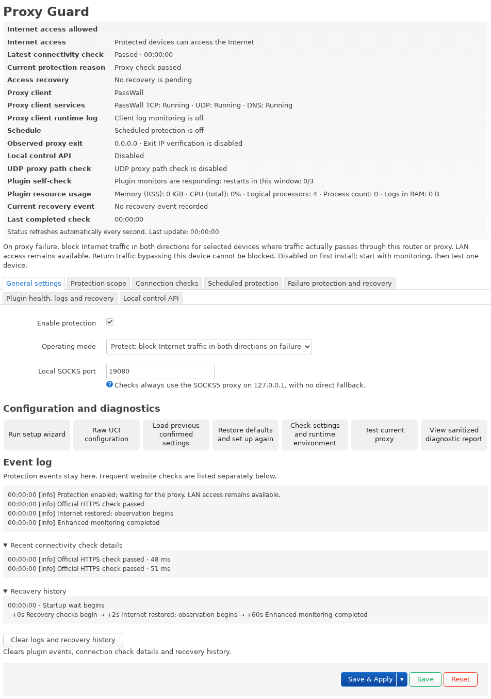

# Proxy Guard

[English](README.md) · [简体中文](docs/README.zh-CN.md) · [日本語](docs/README.ja.md) · [Русский](docs/README.ru.md) · [فارسی](docs/README.fa.md)

**Block unintended direct connections from protected devices when the proxy fails.**

**Supported proxy clients:** PassWall · PassWall2 · OpenClash · Nikki · HomeProxy. See [version and mode compatibility](docs/COMPATIBILITY.md).

Proxy Guard protects proxy connections on OpenWrt / iStoreOS. With protection enabled, a confirmed proxy failure automatically blocks Internet traffic from selected devices, reducing the risk of unintended direct connections and exposure of your real IP. Access resumes after recovery checks pass.

Only traffic from these devices that actually traverses this router is covered. Configured LAN, DNS and management exceptions remain available.

## Versions

Standard provides proxy connection protection on the router without cloud components. Pro adds VPS access control to Standard and requires a separately deployed Linux Agent; Cloudflare is optional.

| Feature | Standard `0.3.0-21` | Pro `0.3.1-5` |
| --- | --- | --- |
| Failure, boot and scheduled protection | Included | Uses Standard |
| Wizard, self-checks, logs and watchdog | Included | Uses Standard |
| VPS household IP authorization and selected-port rules | — | Included |
| Emergency SSH and remote maintenance | — | Separate opt-in and authorization |

Download: [GitHub Releases](https://github.com/beezcheyenna/Proxy-Guard/releases) · [Installation guide](docs/USER-GUIDE.en.md#guide-setup) · [Changelog](docs/CHANGELOG.en.md)

> **Choosing Pro:** Most users should use Standard. Pro is not recommended unless you have a specific need for VPS access control or its other advanced features.

## Features

- Proxy-failure protection: connectivity checks through local SOCKS, with optional exit IPv4 and UDP path verification.
- Internet blocking for selected clients: IPv4/IPv6 TCP/UDP traffic in both directions, including established connections that traverse the router.
- Boot and scheduled protection: startup blocking, daily or selected-weekday schedules, and a configurable fixed UTC offset.
- Guided setup and self-checks: recommended scopes, checks after applying, and rollback when a change is not confirmed.
- Live status and event logs: client-service and log monitoring, process supervision and bounded automatic recovery.

## Installation and first setup

1. Install the matching Standard package through LuCI: IPK for opkg firmware, APK for apk firmware. Add a compatible Pro package if you need VPS features.
2. Open “Services → Proxy Guard”, complete the wizard and review SOCKS, the client, ingress interfaces, IPv4 / IPv6 scope and exceptions. Enable checks in “Monitor only”, save and apply, confirm as prompted, then review the results.
3. When ready to enable blocking, select protection mode and “Save & Apply” again. After the self-check passes, **confirm within 30 seconds**. A failed self-check or missing confirmation rolls back the settings. An ordinary proxy outage follows the blocking protection process.

On first installation, protection, exit IPv4 verification and scheduled protection are off. Editing changes the draft; “Save” stages it, and **“Save & Apply” submits it**. The settings page also lets you rerun the wizard, load the last confirmed configuration or edit raw UCI.

## Compatibility and scope

The router requires **opkg or apk, LuCI and firewall4/nftables**. The package format must match the firmware. Client compatibility depends on the version, proxy core and forwarding mode. Pro's Linux Agent requires Python `3.10+`, nftables and systemd / OpenRC.

- Only traffic actually traversing this router is covered. Return traffic may bypass a same-subnet gateway without NAT. Connections initiated by the router itself are outside the client protection scope.
- Configured LAN, DNS and management exceptions remain available. The plugin does not change NAT, interfaces, system routes, DNS or proxy-client configuration.
- IPK and APK packages are not interchangeable. Systems with only fw3/iptables are unsupported. See the compatibility guide for flow offloading, bridge filtering and proxy-core limitations.
- Pro manages explicitly selected VPS local service ports. SSH is configured separately; unselected ports remain subject to the existing firewall.

Installation, upgrades, UI behavior, failure blocking and recovery, IPv4/IPv6 and cold startup have been tested. Start with one client and verify its actual path before expanding the scope. See [compatibility](docs/COMPATIBILITY.md) for requirements and known limitations.

## Documentation

- [Full user guide](docs/USER-GUIDE.en.md)
- [Installation, upgrades and removal](docs/USAGE.md)
- [Compatibility](docs/COMPATIBILITY.md)
- [Exact test matrix](docs/TEST-MATRIX.md)
- [Recovery](docs/RECOVERY.md)
- [Linux Agent installation](docs/LINUX-AGENT-INSTALL.md)
- [Cloudflare companion](docs/CLOUDFLARE-WORKER.md)
- [Log compatibility](docs/LOG_COMPATIBILITY.md)
- [Building from source](docs/BUILDING.md)

## License and support

Report security vulnerabilities privately to [beezcheyenna268@gmail.com](mailto:beezcheyenna268@gmail.com). Do not publish unfixed exploit details, real VPS addresses or credentials. Ordinary bugs can be reported through a sanitized Issue.

**This project is intended for development, testing and technical research.** Use it on authorized devices and networks, and comply with the laws applicable where it is used and deployed. The software is provided “as is” under the existing [MIT License](LICENSE), without a guarantee of suitability for every situation. Risks and liability are governed by the applicable licenses and law. This notice does not modify the existing licenses or exclude liability that cannot legally be excluded.

[Security policy](docs/SECURITY.en.md) · [Disclaimer](docs/DISCLAIMER.en.md) · [Privacy](docs/PRIVACY.en.md) · [Third-party notices](docs/THIRD_PARTY_NOTICES.md)

[Contributing](CONTRIBUTING.md)
