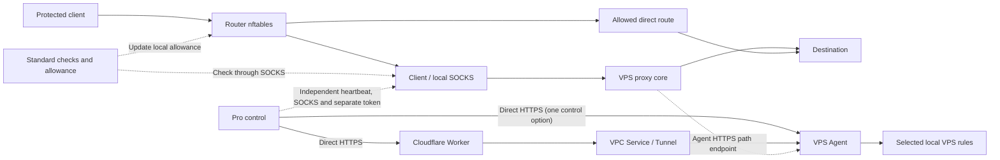

# Pro VPS Agent and control paths

[English](PRO-COMPANION.en.md) · [简体中文](PRO-COMPANION.md) · [日本語](PRO-COMPANION.ja.md) · [Русский](PRO-COMPANION.ru.md) · [فارسی](PRO-COMPANION.fa.md)

Standard `0.3.0-21` and Pro `0.3.1-5` run on the router. Deploy the Linux VPS Agent and optional Cloudflare Worker from `companion/` separately. Use either direct HTTPS or a Worker with Tunnel/VPC. Agent protocol and Worker tool versions are independent of the router packages.

## Preparation and installation

Linux needs Python 3.10+, nftables and kernel support for nf_conntrack, nf_conncount, and nft_connlimit. The installer uses systemd or OpenRC and checks rules and kernel capabilities before enabling limits. Copy `vps/agent.example.json` to a private configuration in the extracted `companion/` checkout. See [Linux Agent installation](LINUX-AGENT-INSTALL.en.md).

- Set `device_id` and a random independent `agent_secret` of at least 32 characters. Use a separate `direct_token` for the router's device secret in direct mode.
- A public listener needs explicit `public_control=true`, `bind`, `tls_cert`, and `tls_key` with a valid certificate. HTTP is allowed on loopback.
- Under `services` enter actual `process_names`, `tcp_ports`, and `udp_ports`. An empty port list checks the process only.
- In `managed_units` use the actual `name.service` of each managed proxy. On OpenRC remove the `.service` suffix to get the service name. SSH is excluded.
- Use a separate `path_token`. Send the path heartbeat through OpenWrt's local SOCKS to the Agent HTTPS path. Direct mode can reuse the base URL with separate routes and tokens. In Cloudflare mode provide a separate Agent HTTPS entry. See [connection settings](LINUX-AGENT-INSTALL.en.md#control-and-path).

Validate first. The example below uses systemd and `sudo`.

```sh
python3 vps/agent.py --config /path/to/private-agent.json --check-config
sudo python3 vps/agent.py --config /path/to/private-agent.json --check-kernel
sudo sh vps/install.sh --install /path/to/private-agent.json
```

Installation preserves an existing config. The policy service restores the last valid policy before configured proxy units. Dynamic leases require fresh authentication after cold boot. Verify target boot order, early initrd networking, unmanaged services, and external firewall reload behavior.

To remove the component:

```sh
sudo sh vps/uninstall.sh --remove
```

Removal cleans its services and rules, retaining the configuration, keys and program. See [recovery](RECOVERY.en.md).

## Ports and three modes

Discovery lists candidates. Select local INPUT ports explicitly. Docker forwarding and unselected ports remain under system rules, and routing and NAT are preserved.

- **Allowlist:** accepts permitted household leases, static or rule-specific sources. Revocation can affect existing inbound connections.
- **Standard (default):** limits new and concurrent connections from unknown sources by IP, destination port, and protocol. Source mode controls household/static exemptions. Authenticated traffic keeps its applicable trusted-flow policy. Selecting all sources still applies Standard limits.
- **Observe:** records selected-port events. Separately managed SSH follows its own policy.

In direct mode, enter the Agent base URL, `device_id` and `direct_token` in LuCI. Verify direct routing for both control options. In direct HTTPS mode, the Agent reads the real source IP. In Cloudflare mode, the Worker observes and forwards it in a signed request. Default lease is 900 seconds and sync interval 300 seconds. Stopping sync lets kernel leases expire. Management defaults to IPv4. Check any IPv6 control deployment independently. Static rules are independent of leases.

The optional remote-health requirement defaults to off. When enabled, missing, stale, or failed health prevents the local allowance. Recovery still requires the SOCKS checks. Use real proxy requests in addition to listener checks.

### Panel and subscription ports

Separate unselected panel, API, and subscription ports follow system rules. Selected ports and endpoints sharing the same IP, protocol, and port are subject to the selected rule. URL path and SNI cannot separate them at this layer.

## Managed SSH and rescue

Managed SSH is opt-in. Confirm a live SSH listener, authorized session, current household address, and two fresh authenticated heartbeats. The SSH service and authentication remain under system management.

Rescue follows continuous loss of both control and independent path heartbeats, default **60 seconds**. The default rescue scope is public. You can restrict it to management and the last authenticated household addresses. New duration `0` means open until household authorization recovers. Choose `30`–`3600` seconds for timed access. Existing explicit durations are preserved. Existing management sessions remain. Kernel behavior permits rescue after the wait even if the Agent pauses. Restarts within one boot preserve the timeout.

Public rescue increases exposure. Timed expiry with a changed IP and no allowed management source can prevent login. SSH authentication, the system firewall, and provider security groups still apply. Restoration requires authenticated control and renewed household authorization. Status and path heartbeats alone cannot end rescue.

## Fixed remote maintenance

Authorize VPS reboot and Xray restart separately on both router and Agent. Set `maintenance` `adapter`, `unit`, `service` and `verify_seconds`. The systemd adapter targets the permitted Xray unit. For 3x-ui, confirm the selected release's USR1 support. The operation restarts Xray, leaving the panel running.

Operation IDs are deduplicated persistently. On interruption or unknown result, query using the original ID. Xray restart requires a new process generation and health. VPS reboot requires a new boot ID and health. Local protection precedes maintenance. After actual recovery, traffic resumes with enhanced monitoring. A new failure returns to blocking wait.

## REALITY and log data

`reality.config_path` reads inbound configuration, targets, and SNI. `probe_enabled` enables bounded TLS target checks. Keep the Xray configuration and keys private.

`access_log` can establish an authenticated source only when inbound tags and authentication fields match. SNI alone does not establish identity. Precise fallback limits require fresh private `telemetry_file` JSONL from a trusted local source and match source IP/port, service port, and protocol. Without telemetry, precise classification is unavailable. Use `log_uid` for a trusted non-root log owner. Events, cursors, tracked sets, and API sizes are bounded. Heartbeat runtime state is in RAM and deduplication records persist.

## Cloudflare companion

The [Worker](CLOUDFLARE-WORKER.en.md) authenticates devices, observes the source and relays signed control through the fixed VPC binding and `cloudflared`. `DEVICE_TOKEN` and `AGENT_SECRET` serve separate hops. Deploy with Wrangler after preparing the Agent, Tunnel and VPC Service. Verify authentication, the household lease, control, and the independent path.

## Tests and compatibility

Tests covered multiple systems, installation, cold boot, 3x-ui/Xray, selected ports, authenticated API, and Cloudflare integration. See [compatibility](COMPATIBILITY.en.md) and the [test matrix](TEST-MATRIX.en.md). Upgrade hooks preserve existing protection. After interruption, inspect live rules and services.

- <https://xtls.github.io/en/config/transports/reality.html>
- <https://github.com/MHSanaei/3x-ui/tree/v3.11.0>
- <https://developers.cloudflare.com/workers-vpc/get-started/>
- <https://developers.cloudflare.com/workers/platform/deploy-buttons/>

## Control and data paths



Solid lines show traffic and control connections. Dashed lines show checks, local allowances, and independent heartbeats. Control is direct to observe the household source. The path heartbeat goes through SOCKS. See [endpoint configuration](LINUX-AGENT-INSTALL.en.md#control-and-path).

### Failure behavior

| Trigger | Standard on the router | VPS / Pro |
| --- | --- | --- |
| SOCKS/HTTPS failure | Normal or enhanced failure rule, then configured recovery | Existing selected-port policy. One failed probe does not open SSH. |
| Monitoring only | Logs and status without blocking | Enabled remote policy continues independently. |
| Router reboots with boot protection | Holds covered traffic pending services and recovery | Synchronization pauses while the VPS enforces existing policy and leases. |
| Control lost | Optional remote-health gate can withhold the allowance | Dynamic leases expire. Static and selected-port rules remain. |
| One heartbeat lost | Local checks continue | Both paths must fail for SSH rescue. |
| Both heartbeats lost after confirmed managed SSH | Local protection keeps its scope | After the configured delay, relaxes its own SSH rule for the chosen scope and duration. |
| Standard stopped or failed | Blocking can remain and allowances expire | VPS policy is separate. |
| Unconfirmed trial or lost control response | Shows pending, rollback or unknown result | Check policy and persistent state. A timed-out trial restores the previous policy. |

Actual timing depends on configuration and check duration. See [recovery](RECOVERY.en.md).
