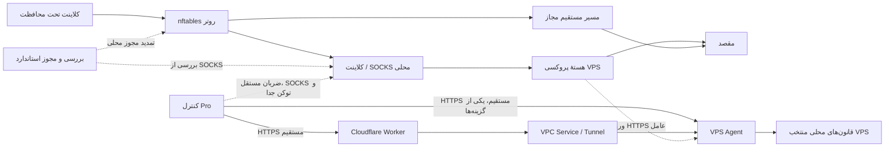

# عامل VPS و مسیرهای کنترل Pro

[English](PRO-COMPANION.en.md) · [简体中文](PRO-COMPANION.md) · [日本語](PRO-COMPANION.ja.md) · [Русский](PRO-COMPANION.ru.md) · [فارسی](PRO-COMPANION.fa.md)

<div dir="rtl" lang="fa">

استاندارد `0.3.0-21` و Pro `0.3.1-5` روی روتر اجرا می‌شوند. Linux VPS Agent و Worker اختیاری را جدا از `companion/` مستقر کنید. HTTPS مستقیم یا Worker با Tunnel/VPC را انتخاب کنید. نسخهٔ پروتکل Agent و ابزار Worker مستقل از بسته‌اند.

## آماده‌سازی و نصب

Linux، Python 3.10 یا بالاتر، nftables و پشتیبانی هسته از nf_conntrack، nf_conncount و nft_connlimit لازم‌اند. نصب‌کننده با systemd یا OpenRC پیش از فعال کردن محدودیت، تنظیم و هسته را می‌سنجد. `vps/agent.example.json` را در `companion/` استخراج‌شده به تنظیم خصوصی کپی کنید. [نصب Agent](LINUX-AGENT-INSTALL.fa.md) را ببینید.

- `device_id` و `agent_secret` تصادفی و جداگانه با دست‌کم ۳۲ نویسه بدهید. برای کنترل مستقیم، `direct_token` جداگانه را روی روتر وارد کنید.
- شنوندهٔ عمومی به `public_control=true`، `bind` و `tls_cert` و `tls_key` معتبر نیاز دارد. HTTP روی loopback مجاز است.
- در `services` مقادیر واقعی `process_names`، `tcp_ports` و `udp_ports` را بدهید. فهرست خالی فقط فرایند را می‌سنجد.
- در `managed_units` سرویس واقعی `name.service` را مشخص کنید. در OpenRC نام بدون `.service` است. SSH بیرون از این فهرست است.
- `path_token` جداگانه برای ضربان از SOCKS محلی تا ورودی HTTPS Agent است. در کنترل مستقیم، پایهٔ مشترک با مسیر و توکن جدا ممکن است. در Cloudflare ورودی مستقل HTTPS لازم است. [تنظیم اتصال](LINUX-AGENT-INSTALL.fa.md#control-and-path) را ببینید.

ابتدا بررسی و سپس روی VPS مقصد نصب کنید. نمونه برای systemd و `sudo` است.

```sh
python3 vps/agent.py --config /path/to/private-agent.json --check-config
sudo python3 vps/agent.py --config /path/to/private-agent.json --check-kernel
sudo sh vps/install.sh --install /path/to/private-agent.json
```

پیکربندی فعال قبلی حفظ می‌شود. سرویس سیاست پیش از پروکسی‌های مشخص‌شده آخرین سیاست معتبر را برمی‌گرداند. مجوز پویا پس از راه‌اندازی سرد به احراز هویت نیاز دارد. ترتیب شروع، شبکهٔ زودهنگام initrd، سرویس مدیریت‌نشده و بارگذاری فایروال را در مقصد بررسی کنید.

برای حذف مؤلفه:

```sh
sudo sh vps/uninstall.sh --remove
```

سرویس و قانون خود را حذف و تنظیم، کلید و برنامه را حفظ می‌کند. [بازیابی](RECOVERY.fa.md) را ببینید.

## پورت‌ها و سه حالت

کشف خودکار نامزد می‌دهد. پورت محلی INPUT را صریح انتخاب کنید. ارسال Docker، پورت انتخاب‌نشده، مسیر و NAT در اختیار سیستم می‌مانند.

- **فهرست مجاز:** مجوز پویای خانگی، مبدأ ثابت و مبدأ مجاز همان قانون را می‌پذیرد. لغو مجوز روی اتصال ورودی موجود هم اثر می‌گذارد.
- **استاندارد (پیش‌فرض):** نرخ اتصال تازه و اتصال هم‌زمان را برای مبدأ ناشناخته بر اساس IP، پورت مقصد و پروتکل محدود می‌کند. استثنای خانگی و ثابت تابع حالت مبدأ است و ترافیک احراز‌شده سیاست معتبر خود را دارد. انتخاب همهٔ مبدأها محدودیت استاندارد را حفظ می‌کند.
- **مشاهده:** رویداد پورت منتخب را ثبت می‌کند. SSH با مدیریت جداگانه، تابع سیاست خود است.

در LuCI برای HTTPS مستقیم، URL پایهٔ Agent، `device_id` و `direct_token` را وارد کنید. مستقیم بودن هر دو گزینهٔ کنترل را بسنجید. در HTTPS مستقیم، Agent نشانی IP واقعی مبدأ را می‌خواند. در حالت Cloudflare، Worker آن را مشاهده و در درخواست امضاشده ارسال می‌کند. مجوز پیش‌فرض ۹۰۰ و فاصلهٔ همگام‌سازی ۳۰۰ ثانیه است. توقف همگام‌سازی باعث انقضا می‌شود. کنترل پیش‌فرض IPv4 است. IPv6 جدا بررسی می‌شود. قانون ثابت مستقل از مهلت پویاست.

شرط سلامت راه‌دور پیش‌فرض خاموش است. در حالت فعال، نبود، انقضا یا خطای گزارش جلوی مجوز محلی را می‌گیرد. بازیابی آزمون SOCKS هم می‌خواهد. علاوه بر شنونده، درخواست واقعی را بررسی کنید.

### پورت پنل و اشتراک

پنل، API و اشتراک جداگانهٔ انتخاب‌نشده تابع قانون سیستم‌اند. پورت انتخابی یا ورودی با IP، پروتکل و پورت مشترک، تابع همان قانون است. در این لایه مسیر URL یا SNI آن‌ها را جدا نمی‌کند.

## مدیریت و نجات SSH

مدیریت SSH صریح فعال می‌شود. شنونده، نشست مجاز، نشانی خانگی فعلی و دو ضربان تازهٔ احراز هویت‌شده را بررسی کنید. سرویس و احراز هویت SSH با سیستم می‌مانند.

قطع پیوستهٔ هر دو مسیر کنترل و پروکسی پس از زمان تنظیمی، پیش‌فرض **۶۰ ثانیه**، نجات را فعال می‌کند. دامنه پیش‌فرض عمومی است و می‌توان به مبدأ مدیریت و آخرین نشانی خانگی محدود کرد. مدت تازهٔ `0` تا بازیابی مجوز خانگی و `30` تا `3600` ثانیه زمان‌دار است. مقدار صریح قبلی و نشست مدیریت موجود حفظ می‌شوند. هسته حتی در وقفهٔ Agent پس از انتظار مجوز می‌دهد. راه‌اندازی فرایند در همان بوت زمان را حفظ می‌کند.

نجات عمومی مدت دسترسی را بیشتر می‌کند. اگر بعد از انقضا IP خانه عوض شده و مبدأ مجاز نیست، ورود تازه ممکن است ناموفق باشد. احراز هویت SSH، فایروال و گروه امنیتی ارائه‌دهنده اعمال می‌شوند. پایان نجات به کنترل احراز هویت‌شده و تمدید مجوز خانه نیاز دارد.

## نگهداری راه‌دور ثابت

راه‌اندازی VPS و Xray را در هر دو سمت جداگانه مجاز کنید. در `maintenance`، `adapter`، `unit`، `service` و `verify_seconds` را تنظیم کنید. systemd فقط واحد مجاز Xray را هدف می‌گیرد. در 3x-ui، پشتیبانی USR1 نسخه را تأیید کنید. پنل فعال می‌ماند.

شناسهٔ عملیات به‌صورت پایدار از تکرار جلوگیری می‌کند. در وقفه یا نتیجهٔ نامعلوم، همان شناسه را استعلام کنید. Xray نسل فرایند تازه و سلامت، VPS شناسهٔ بوت تازه و سلامت می‌خواهد. پیش از نگهداری محافظت محلی برقرار می‌شود. بعد از بازیابی واقعی ترافیک در پایش تقویت‌شده برقرار است. خرابی تازه به انتظار مسدودسازی برمی‌گردد.

## REALITY و دادهٔ گزارش

`reality.config_path` ورودی، مقصد و SNI را می‌خواند. `probe_enabled` بررسی TLS محدود را فعال می‌کند. پیکربندی و کلید خصوصی می‌مانند.

`access_log` فقط با تطبیق برچسب ورودی و فیلد احراز هویت، مبدأ معتبر را ثابت می‌کند. SNI به‌تنهایی هویت نیست. محدودیت دقیق fallback به `telemetry_file` تازه و خصوصی JSONL از برنامهٔ محلی مورد اعتماد نیاز دارد و IP و پورت مبدأ، پورت سرویس و پروتکل را تطبیق می‌دهد. بدون داده، دسته‌بندی در دسترس نیست. برای مالک گزارش غیر root از `log_uid` استفاده کنید. رویداد، نشانگر، مجموعهٔ ردیابی و API حد دارند. ضربان در RAM و شناسهٔ جلوگیری از تکرار پایدار است.

## مؤلفهٔ Cloudflare

[Worker](CLOUDFLARE-WORKER.fa.md) احراز هویت، مشاهدهٔ مبدأ و انتقال امضاشدهٔ کنترل را از اتصال ثابت VPC و `cloudflared` انجام می‌دهد. `DEVICE_TOKEN` و `AGENT_SECRET` برای دو مسیرند. پیش از Wrangler، Agent، Tunnel و VPC Service را بسازید و احراز هویت، مجوز خانه، کنترل و مسیر مستقل را بررسی کنید.

## آزمون و سازگاری

چند سیستم، نصب، راه‌اندازی سرد، 3x-ui/Xray، پورت منتخب، API احراز هویت و Cloudflare آزموده شدند. [سازگاری](COMPATIBILITY.fa.md) و [ماتریس آزمون](TEST-MATRIX.fa.md) را ببینید. اسکریپت ارتقا محافظت موجود را نگه می‌دارد. بعد از وقفه، قانون و سرویس فعال را بسنجید.

- <https://xtls.github.io/en/config/transports/reality.html>
- <https://github.com/MHSanaei/3x-ui/tree/v3.11.0>
- <https://developers.cloudflare.com/workers-vpc/get-started/>
- <https://developers.cloudflare.com/workers/platform/deploy-buttons/>

## مسیر کنترل و داده



خط پیوسته ترافیک و کنترل و خط چین بررسی، مجوز و ضربان مستقل است. کنترل برای دیدن مبدأ خانه مستقیم است و ضربان مسیر از SOCKS می‌گذرد. [تنظیم ورودی](LINUX-AGENT-INSTALL.fa.md#control-and-path) را ببینید.

### رفتار هنگام خرابی

| شرط | استاندارد روی روتر | VPS / Pro |
| --- | --- | --- |
| خطای SOCKS/HTTPS | مسدودسازی و بازیابی طبق حالت فعلی | سیاست موجود برقرار است. یک خطا SSH را باز نمی‌کند. |
| فقط پایش | ثبت گزارش و وضعیت بدون مسدودسازی | سیاست راه‌دور فعال مستقل عمل می‌کند. |
| راه‌اندازی دوباره با محافظت شروع | ترافیک تحت پوشش تا آمادگی و بازیابی نگه داشته می‌شود | همگام‌سازی موقت قطع و سیاست و مجوز موجود اجرا می‌شود. |
| قطع کنترل | شرط اختیاری سلامت می‌تواند مجوز را نگه دارد | مجوز پویا منقضی و قانون ثابت حفظ می‌شود. |
| قطع یک ضربان | بررسی محلی ادامه دارد | نجات به قطع هر دو نیاز دارد. |
| قطع دو ضربان در SSH تأییدشده | دامنهٔ محافظت محلی برقرار | پس از تأخیر، محدودیت خود مؤلفه برای دامنه و مدت تنظیمی سبک می‌شود. |
| توقف یا خرابی استاندارد | مسدودسازی ممکن است بماند و مجوز منقضی شود | سیاست VPS جداست. |
| اجرای تأییدنشده یا پاسخ گم‌شده | در انتظار، بازگشت یا نتیجهٔ نامعلوم | سیاست و وضعیت پایدار بررسی شوند. انقضا سیاست قبلی را برمی‌گرداند. |

زمان واقعی تابع تنظیمات و مدت آزمون است. [بازیابی](RECOVERY.fa.md) را ببینید.

</div>
