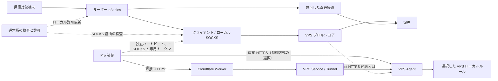

# Pro VPS Agent と制御経路

[English](PRO-COMPANION.en.md) · [简体中文](PRO-COMPANION.md) · [日本語](PRO-COMPANION.ja.md) · [Русский](PRO-COMPANION.ru.md) · [فارسی](PRO-COMPANION.fa.md)

通常版 `0.3.0-21` と Pro `0.3.1-5` はルーター用です。`companion/` の Linux VPS Agent と任意の Cloudflare Worker を別に配備します。直接 HTTPS、または Worker と Tunnel/VPC を選べます。Agent プロトコルとツールの版番号はパッケージと独立しています。

## 準備と導入

Linux、Python 3.10 以降、nftables、nf_conntrack、nf_conncount、nft_connlimit が必要です。systemd または OpenRC を使い、制限の有効化前に設定とカーネルを検査します。展開した `companion/` の `vps/agent.example.json` を非公開設定にコピーします。[導入手順](LINUX-AGENT-INSTALL.ja.md) を参照してください。

- `device_id` と 32 文字以上のランダムな `agent_secret` を設定します。直接制御には機器側と一致する別の `direct_token` を使います。
- 公開リスナーには `public_control=true`、`bind`、有効な `tls_cert` と `tls_key` が必要です。HTTP はループバックのみです。
- `services` の `process_names`、`tcp_ports`、`udp_ports` に実際の値を設定します。ポートなしではプロセスのみを確認します。
- `managed_units` は実プロキシの `name.service` を指定します。OpenRC は `.service` を除いた名前に対応します。SSH は対象外です。
- 独立 `path_token` でローカル SOCKS から Agent の HTTPS 経路へハートビートを送ります。直接制御と同じベース URL でも経路とトークンは別です。Cloudflare では別の Agent HTTPS 入口が必要です。[接続設定](LINUX-AGENT-INSTALL.ja.md#control-and-path) を確認します。

検証してから対象 VPS に導入します。以下は systemd と `sudo` の例です。

```sh
python3 vps/agent.py --config /path/to/private-agent.json --check-config
sudo python3 vps/agent.py --config /path/to/private-agent.json --check-kernel
sudo sh vps/install.sh --install /path/to/private-agent.json
```

既存設定は保持します。ポリシーサービスは指定プロキシの起動前に最後の有効なポリシーを復元します。コールドスタート後は動的リースを再認証します。起動順、initrd の先行通信、管理外サービス、外部ファイアウォール再読み込みは配備先で確認します。

コンポーネントの削除:

```sh
sudo sh vps/uninstall.sh --remove
```

専用サービスとルールを削除し、設定、鍵、プログラムは保持します。[復旧](RECOVERY.ja.md) を参照してください。

## ポートと 3 つのモード

検出は候補を表示します。ローカル INPUT ポートを明示的に選択します。Docker 転送と未選択ポートはシステムのルールに従い、ルーティングと NAT は維持されます。

- **許可リスト:** 家庭の動的リース、固定送信元、ルールで許可した送信元を通します。許可の撤回は既存の着信にも影響します。
- **標準（既定）:** 不明な送信元の新規・同時接続を IP、宛先ポート、プロトコルごとに制限します。家庭・固定送信元の例外は送信元モードに従い、認証済み通信は既存方針に従います。全送信元でも標準制限を適用します。
- **観察:** 選択ポートのイベントを記録します。独立した SSH 管理には自身のポリシーを適用します。

LuCI の直接制御に Agent ベース URL、`device_id`、`direct_token` を設定します。両制御方式の直通を確認します。直接 HTTPS では Agent が実際の送信元 IP を読みます。Cloudflare モードでは Worker が観測して署名付き要求で転送します。既定リースは 900 秒、同期は 300 秒です。同期を止めるとリースは満了します。既定の管理は IPv4 です。IPv6 は別途確認してください。固定ルールはリースと独立です。

リモート正常性条件は既定で無効です。有効時、欠落・期限切れ・障害の報告は許可を保留します。復旧には SOCKS 検証も必要です。リスナーに加えて実際の要求を確認します。

### パネルと購読ポート

未選択の独立パネル、API、購読はシステム規則に従います。選択ポートや IP・プロトコル・ポート共用の入口は該当ルールに従います。この層では URL パスや SNI で分離できません。

## SSH 管理と救済

SSH は明示的に有効化します。実リスナー、許可済みセッション、現在の家庭アドレス、認証済みの新しい 2 経路を確認します。SSH サービスと認証はシステム側で管理します。

制御と独立経路が両方途絶え、既定 **60 秒**で救済します。既定は公開で、管理元と最後に認証した家庭アドレスに限定できます。新規の `0` は家庭側の許可復旧まで、`30`～`3600` 秒は期限付きです。既存の明示値と管理接続は維持します。Agent 停止中もカーネルが待ち時間後に許可し、同じ起動内のプロセス再起動は残り時間を維持します。

公開時間が長くなります。期限後、家庭 IP が変わり許可送信元がないとログインできない場合があります。SSH 認証、システム規則、事業者のセキュリティグループは有効です。救済の終了には認証済み制御と家庭許可の更新が必要です。

## 定義済みリモートメンテナンス

VPS と Xray の再起動は両端で個別に許可します。`maintenance` の `adapter`、`unit`、`service`、`verify_seconds` を設定します。systemd は許可された Xray ユニットを対象にします。3x-ui は対象版の USR1 を確認し、パネルを維持して Xray を再起動します。

操作 ID の重複排除は永続です。中断や結果不明時は元の ID を照会します。Xray はプロセス世代、VPS は boot ID の変更と正常性を確認します。操作前にローカル保護を開始し、実際の復旧後は通信を再開して強化監視します。再障害は遮断待ちに戻ります。

## REALITY とログデータ

`reality.config_path` でインバウンド、宛先、SNI を読み取ります。`probe_enabled` は予算付き TLS 検査です。設定と秘密鍵は非公開です。

`access_log` で認証済み送信元を確認するにはインバウンドタグと認証項目の対応が必要です。SNI だけで本人性は確認しません。正確なフォールバック制限は信頼できるローカルの新鮮な非公開 `telemetry_file` JSONL を使い、送信元 IP・ポート、サービスポート、プロトコルを照合します。データがなければ分類は利用不可です。非 root の信頼できるログ所有者は `log_uid` で指定します。イベント、カーソル、追跡セット、API サイズに上限があり、ハートビートは RAM、重複排除は永続です。

## Cloudflare 連携

[Worker](CLOUDFLARE-WORKER.ja.md) は認証、送信元観測、署名制御の中継を担当します。固定 VPC バインディングと `cloudflared` を使います。`DEVICE_TOKEN` と `AGENT_SECRET` を分けます。Agent、Tunnel、VPC Service を準備してから Wrangler で配備し、認証、家庭リース、制御、独立経路を確認します。

## テストと互換性

複数システム、導入、コールドスタート、3x-ui/Xray、選択ポート、認証 API、Cloudflare を検証しました。[互換性](COMPATIBILITY.ja.md) と [テストマトリクス](TEST-MATRIX.ja.md) を参照してください。更新フックは保護を維持します。中断後は実ルールとサービスを確認します。

- <https://xtls.github.io/en/config/transports/reality.html>
- <https://github.com/MHSanaei/3x-ui/tree/v3.11.0>
- <https://developers.cloudflare.com/workers-vpc/get-started/>
- <https://developers.cloudflare.com/workers/platform/deploy-buttons/>

## 制御経路とデータ経路



実線は通信と制御、破線は検査、許可、独立ハートビートです。制御は家庭側送信元を観測するため直通、経路ハートビートは SOCKS 経由です。[入口設定](LINUX-AGENT-INSTALL.ja.md#control-and-path) を参照してください。

### 障害時の動作

| 条件 | ルーターの通常版 | VPS / Pro |
| --- | --- | --- |
| SOCKS/HTTPS 失敗 | 通常または強化監視の規則で遮断し、設定に従い復旧 | 既存ルールを維持。単発失敗で SSH 救済は開始しない。 |
| 監視のみ | 遮断せずログと状態を表示 | リモートポリシーは独立して動作。 |
| 起動時保護付き再起動 | サービスと復旧を待つ間、対象通信を遮断 | 同期が止まる間も既存ルールとリースを適用。 |
| 制御途絶 | 任意のリモート正常性条件が許可に影響 | リースは満了し、固定・選択ポート規則は維持。 |
| 片方だけ途絶 | ローカル検査を継続 | 救済には両経路の途絶が必要。 |
| 確認済み SSH 管理で両経路途絶 | ローカル保護の範囲を維持 | 設定時間後に対象と期間に従い専用 SSH 制限を緩和。 |
| 通常版の停止・障害 | 遮断が残り、許可は満了し得る | VPS ポリシーは別管理。 |
| 試行未確認・応答消失 | 確認待ち、ロールバック、または結果不明 | ポリシーと永続状態を確認。期限切れで以前の規則に復元。 |

実時間は設定と検査所要時間に依存します。[復旧](RECOVERY.ja.md) を参照してください。
