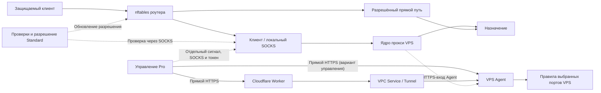

# VPS Agent Pro и каналы управления

[English](PRO-COMPANION.en.md) · [简体中文](PRO-COMPANION.md) · [日本語](PRO-COMPANION.ja.md) · [Русский](PRO-COMPANION.ru.md) · [فارسی](PRO-COMPANION.fa.md)

Standard `0.3.0-21` и Pro `0.3.1-5` работают на роутере. Linux VPS Agent и необязательный Worker из `companion/` разворачиваются отдельно. Доступны прямой HTTPS и Worker с Tunnel/VPC. Версии протокола и инструментов независимы от пакетов.

## Подготовка и установка

Нужны Linux, Python 3.10+, nftables и поддержка nf_conntrack, nf_conncount и nft_connlimit. Установщик использует systemd или OpenRC и проверяет правила и ядро до включения. Скопируйте `vps/agent.example.json` в закрытую конфигурацию в распакованном `companion/`. См. [установку](LINUX-AGENT-INSTALL.ru.md).

- Задайте `device_id` и случайный отдельный `agent_secret` от 32 символов. В прямом режиме секрет роутера — отдельный `direct_token`.
- Публичный слушатель требует `public_control=true`, `bind`, действительных `tls_cert` и `tls_key`. HTTP допускается на loopback.
- Укажите реальные `process_names`, `tcp_ports` и `udp_ports` в `services`. Пустой список портов проверяет только процесс.
- В `managed_units` задайте реальные `name.service`. Для OpenRC это имя без `.service`. SSH исключён.
- Отдельный `path_token` используется для сигнала через локальный SOCKS к HTTPS Agent. В прямом режиме допустим общий базовый URL с разными маршрутами и токенами. Для Cloudflare нужен отдельный HTTPS-вход Agent. См. [настройки подключения](LINUX-AGENT-INSTALL.ru.md#control-and-path).

Сначала проверьте конфигурацию. Ниже пример для systemd и `sudo`.

```sh
python3 vps/agent.py --config /path/to/private-agent.json --check-config
sudo python3 vps/agent.py --config /path/to/private-agent.json --check-kernel
sudo sh vps/install.sh --install /path/to/private-agent.json
```

Действующая конфигурация сохраняется. Служба политики восстанавливает последнее допустимое правило до настроенных служб прокси. После холодного запуска нужно заново подтвердить динамическое разрешение. Проверьте порядок запуска, раннюю сеть initrd, неуправляемые службы и перезагрузку внешнего экрана.

Удаление компонента:

```sh
sudo sh vps/uninstall.sh --remove
```

Удаляются его службы и правила. Настройки, ключи и программа сохраняются. См. [восстановление](RECOVERY.ru.md).

## Порты и три режима

Обнаружение предлагает кандидатов. Выбирайте локальные INPUT-порты явно. Docker, невыбранные порты, маршруты и NAT остаются в ведении системы.

- **Список допуска:** принимает динамическое домашнее разрешение, статические и явно разрешённые источники. Отзыв затрагивает существующие входящие соединения.
- **Стандартный (по умолчанию):** ограничивает скорость новых и число одновременных подключений неизвестных источников по IP, порту и протоколу. Исключения для домашних и статических источников зависят от режима источника. Доверенный трафик следует своей политике. Все источники по-прежнему подпадают под стандартное ограничение.
- **Наблюдение:** записывает события выбранных портов. Отдельно управляемый SSH следует своей политике.

Для прямого HTTPS задайте базовый URL Agent, `device_id` и `direct_token` в LuCI. Проверьте прямую маршрутизацию обоих вариантов управления. При прямом HTTPS Agent читает реальный IP источника. В режиме Cloudflare его наблюдает Worker и пересылает в подписанном запросе. По умолчанию разрешение действует 900 секунд, синхронизация каждые 300 секунд. После остановки разрешения истекают. Управление по умолчанию IPv4, IPv6 проверяйте отдельно. Статические правила независимы.

Необязательная проверка удалённого здоровья изначально выключена. После включения отсутствующий, просроченный или неуспешный отчёт удерживает локальную блокировку. Для восстановления также нужен SOCKS-тест. Проверьте реальный запрос вместе с портом.

### Панель и подписки

Невыбранные отдельные порты панели, API и подписок следуют системным правилам. Выбранный или общий IP/протокол/порт подпадает под выбранное правило. URL-путь и SNI на этом уровне не разделяются.

## Управление SSH и аварийный доступ

Включается явно. Проверьте слушатель, разрешённый сеанс, текущий домашний адрес и два свежих аутентифицированных сигнала. Служба и аутентификация SSH остаются системными.

Аварийный доступ начинается после непрерывной потери обоих сигналов, по умолчанию **60 секунд**. Охват по умолчанию публичный, можно ограничить адресами управления и последним домашним IP. Новое значение `0` действует до восстановления домашней авторизации, `30`–`3600` секунд ограничивает срок. Явно заданное прежнее значение и открытые сеансы сохраняются. Ядро соблюдает ожидание и при паузе Agent. Перезапуск процесса в той же загрузке сохраняет таймер.

Публичный доступ увеличивает время доступности порта. При смене IP и отсутствии разрешённого источника истечение срока может закрыть новый вход. SSH, системный экран и группы провайдера действуют. Завершение требует аутентифицированного управления и обновлённого домашнего разрешения.

## Фиксированные операции обслуживания

Разрешите перезагрузку VPS и перезапуск Xray по отдельности с обеих сторон. Задайте `maintenance`: `adapter`, `unit`, `service` и `verify_seconds`. systemd ограничен разрешённым юнитом. Для 3x-ui подтвердите поддержку USR1 нужной версии. Панель остаётся запущенной.

ID операции дедуплицируется постоянно. При прерывании или неизвестном результате запрашивайте исходный ID. Для Xray нужна новая генерация процесса и здоровье, для VPS новый boot ID и здоровье. Перед операцией включается локальная защита. После реального восстановления связь разрешается с усиленным наблюдением. Новый сбой возвращает блокировку.

## REALITY и журналы

`reality.config_path` читает входы, цели и SNI. `probe_enabled` включает проверки TLS с ограниченным бюджетом. Закрытые настройки и ключи остаются приватными.

`access_log` подтверждает источник при совпадении тега входа и полей аутентификации. Один SNI не подтверждает личность. Точное ограничение fallback требует свежего закрытого `telemetry_file` JSONL от доверенной локальной программы с точным сопоставлением IP и порта источника, порта службы и протокола. Без данных классификация недоступна. Для доверенного владельца не root задайте `log_uid`. События, курсоры, наборы и API ограничены по объёму. Сигналы хранятся в RAM, дедупликация — постоянно.

## Компонент Cloudflare

[Worker](CLOUDFLARE-WORKER.ru.md) аутентифицирует, наблюдает IP и пересылает подписанное управление через фиксированный VPC и `cloudflared`. `DEVICE_TOKEN` и `AGENT_SECRET` относятся к разным звеньям. Подготовьте Agent, Tunnel и VPC Service до Wrangler. Проверьте аутентификацию, домашнее разрешение, управление и отдельный путь.

## Проверки и совместимость

Проверялись системы, установка, холодный запуск, 3x-ui/Xray, выбранные порты, аутентифицированный API и Cloudflare. См. [совместимость](COMPATIBILITY.ru.md) и [матрицу](TEST-MATRIX.ru.md). Обработчик обновления сохраняет защиту. После прерывания проверьте живые правила и службы.

- <https://xtls.github.io/en/config/transports/reality.html>
- <https://github.com/MHSanaei/3x-ui/tree/v3.11.0>
- <https://developers.cloudflare.com/workers-vpc/get-started/>
- <https://developers.cloudflare.com/workers/platform/deploy-buttons/>

## Управление и путь данных



Сплошные линии — трафик и управление, пунктир — проверки, разрешения и отдельные сигналы. Управление идёт напрямую для определения домашнего источника, сигнал пути через SOCKS. См. [настройки](LINUX-AGENT-INSTALL.ru.md#control-and-path).

### Поведение при сбоях

| Условие | Standard на роутере | VPS / Pro |
| --- | --- | --- |
| Сбой SOCKS/HTTPS | Блокировка и восстановление по активному режиму | Выбранные правила сохраняются. Один сбой не открывает SSH. |
| Только наблюдение | Журнал и статус без блокировки | Включённая удалённая политика независима. |
| Перезагрузка с защитой запуска | Удерживает трафик до готовности и восстановления | Синхронизация временно остановлена, применяются правила и разрешения. |
| Потеря управления | При включённой проверке здоровья удерживает разрешение | Динамические разрешения истекают, статические правила остаются. |
| Потерян один сигнал | Локальные проверки продолжаются | Для спасения нужны оба сбоя. |
| Оба сигнала потеряны при подтверждённом SSH | Область защиты сохраняется | После ожидания смягчает свои правила SSH для заданного охвата и срока. |
| Standard остановлен или завершился | Блокировка может остаться, разрешения истекают | Удалённая политика отдельна. |
| Проба не подтверждена или ответ потерян | Ожидание, откат или неизвестный результат | Сверьте правила и состояние. При истечении восстанавливается прежняя политика. |

Фактическое время зависит от настроек и длительности проверок. См. [восстановление](RECOVERY.ru.md).
