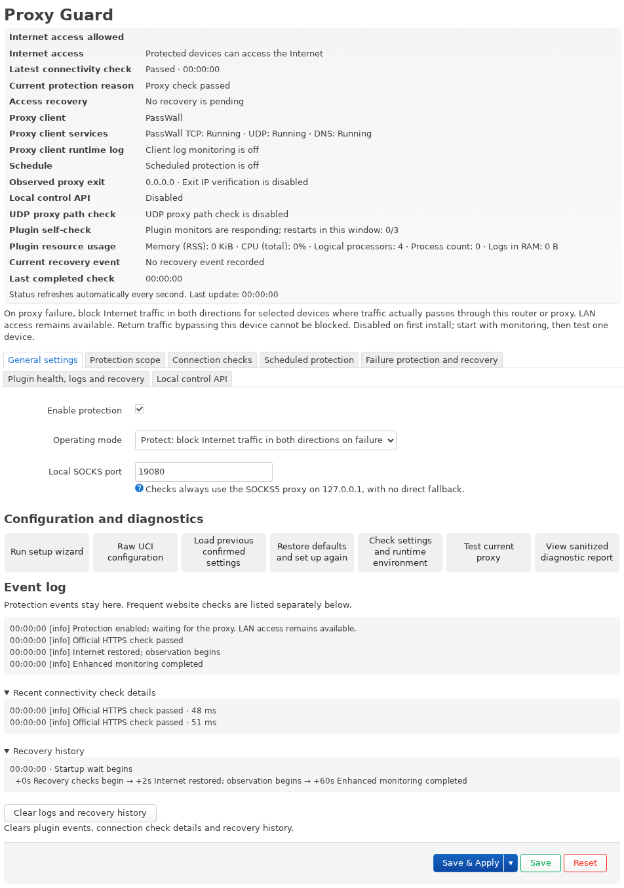

# Proxy Guard

[English](../README.md) · [简体中文](README.zh-CN.md) · [日本語](README.ja.md) · [Русский](README.ru.md) · [فارسی](README.fa.md)

**When the proxy fails, block unintended direct connections from protected devices.**

**Proxy clients:** PassWall · PassWall2 · OpenClash · Nikki · HomeProxy. Support depends on the client version and forwarding mode. [Compatibility guide](COMPATIBILITY.en.md)

Proxy Guard is a LuCI application for OpenWrt and iStoreOS. With protection enabled, it blocks Internet traffic for selected devices after a confirmed proxy failure and restores access after recovery checks pass. Protection covers IPv4 and IPv6, TCP and UDP, including established connections that pass through the router.

## Version 1.0.0

Download the package for your firmware. Use IPK (`1.0.0-8`) with opkg or APK (`1.0.0-r8`) with apk. [GitHub Releases](https://github.com/beezcheyenna/Proxy-Guard/releases) · [Installation guide](USAGE.en.md) · [Changelog](CHANGELOG.md)

## Features

- **Connection checks.** Uses official HTTPS through local SOCKS by default. You can switch to third-party HTTPS and set its own intervals and failure thresholds. Optional exit IPv4 verification uses the official result by default.
- **Startup, scheduled and failure protection.** Covers router startup, daily or selected-weekday schedules, and confirmed proxy failures. Proxy client monitoring can detect service and log events.
- **Guided setup and rollback.** Review the recommended IPv4 and IPv6 scope, then check the applied rules and confirm within 30 seconds. Access status is shown in the confirmation dialog.
- **Live status and diagnostics.** View event logs and recovery history, test the current form settings through SOCKS, or run a one-time detailed HTTPS diagnostic.
- **Optional LAN control API.** Authenticated clients can query status, request a timed block, and cancel their own requests. [API guide](USAGE.en.md#local-api)
- **Client monitoring and automatic recovery.** Watch the configured proxy services and lifecycle logs. A watchdog can restart stalled Proxy Guard processes within configured limits.

## Installation and first setup

1. Install the 1.0 package that matches your firmware through LuCI or from the command line.
2. In LuCI, open **Services → Proxy Guard**. Run the wizard and review the proxy client, SOCKS port, ingress interfaces, address scopes and local exceptions. Start in **Monitor only**, click **Save & Apply**, confirm the settings and verify one device’s traffic path.
3. When ready, select protection mode and click **Save & Apply**. After the self-check, keep the settings within 30 seconds. If the rules need verification, the keep button is disabled while the same countdown continues. Unconfirmed settings roll back automatically.

Protection, scheduled blocking, exit IPv4 verification and the LAN API are off on a fresh installation. **Save** stages edits. **Save & Apply** puts them into effect.

## Compatibility and scope

Use LuCI with firewall4/nftables. Only traffic that actually crosses this router is covered. For example, return traffic can bypass a same-subnet gateway without NAT. Configured LAN, DNS and management exceptions remain available. See the [compatibility guide](COMPATIBILITY.en.md) for forwarding modes and flow offload limits.

## Documentation

[User guide](USER-GUIDE.en.md) · [Installation and removal](USAGE.en.md) · [Recovery](RECOVERY.en.md) · [Build from source](BUILDING.en.md) · [Privacy](PRIVACY.en.md)

[MIT License](../LICENSE) · [Third-party notices](THIRD_PARTY_NOTICES.md) · [Disclaimer](DISCLAIMER.en.md) · [Contributing](../CONTRIBUTING.md)

[Proxy Guard 0.3 archive](../archive/0.3/README.md)
