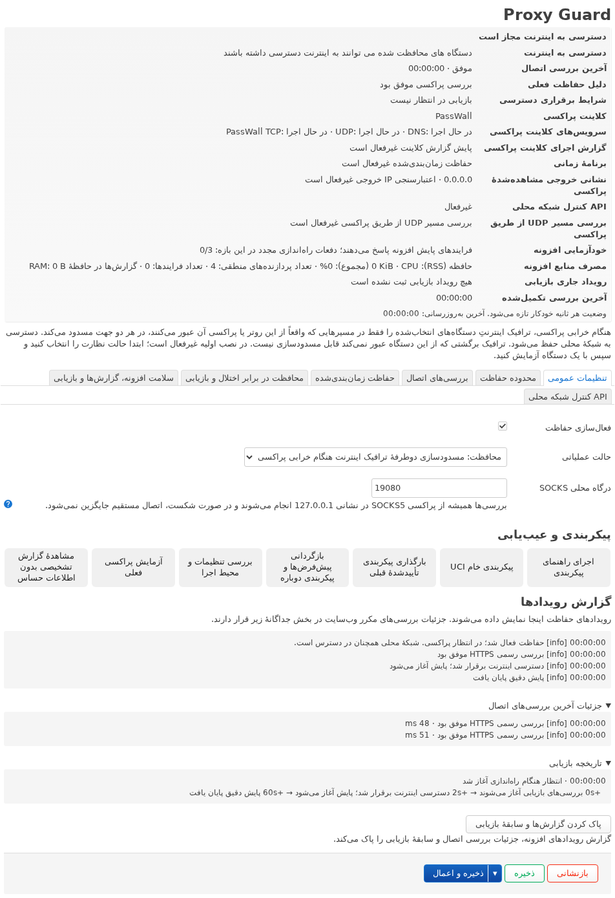

# Proxy Guard

[English](../README.md) · [简体中文](README.zh-CN.md) · [日本語](README.ja.md) · [Русский](README.ru.md) · [فارسی](README.fa.md)

**هنگام خرابی پروکسی، اتصال مستقیم ناخواستهٔ دستگاه‌های تحت محافظت مسدود می‌شود.**

**کلاینت‌های پروکسی پشتیبانی‌شده:** PassWall · PassWall2 · OpenClash · Nikki · HomeProxy. سازگاری به نسخهٔ کلاینت و شیوهٔ هدایت ترافیک بستگی دارد. [راهنمای سازگاری](COMPATIBILITY.fa.md)

Proxy Guard برنامه‌ای برای LuCI روی OpenWrt و iStoreOS است. وقتی محافظت فعال باشد، پس از تأیید خرابی پروکسی اینترنت دستگاه‌های انتخاب‌شده قطع می‌شود و پس از موفقیت بررسی‌های بازیابی دوباره برقرار می‌شود. محافظت شامل ترافیک TCP و UDP روی IPv4 و IPv6 و اتصال‌های از پیش برقرارشده‌ای است که از روتر عبور می‌کنند.

## نسخهٔ ۱٫۰٫۰

بستهٔ متناسب با میان‌افزار را انتخاب کنید. برای opkg از IPK (`1.0.0-8`) و برای apk از APK (`1.0.0-r8`) استفاده کنید. [انتشارها در GitHub](https://github.com/beezcheyenna/Proxy-Guard/releases) · [راهنمای نصب](USAGE.fa.md) · [تغییرات به انگلیسی](CHANGELOG.fa.md)

## قابلیت‌ها

- **بررسی اتصال.** به‌طور پیش‌فرض از سرویس رسمی HTTPS از مسیر SOCKS محلی استفاده می‌شود. می‌توانید وب‌سایت‌های HTTPS دیگر را انتخاب کنید و فاصلهٔ بررسی و آستانهٔ خطا را جداگانه تنظیم کنید. در صورت فعال کردن بررسی IPv4 خروجی، نتیجهٔ سرویس رسمی پیش‌فرض است.
- **محافظت هنگام راه‌اندازی، طبق زمان‌بندی و هنگام خرابی.** می‌توان دسترسی را هنگام راه‌اندازی روتر، هر روز یا در روزهای انتخابی هفته و پس از تأیید خرابی پروکسی قطع کرد. سرویس‌ها و گزارش‌های کلاینت پروکسی نیز قابل پایش‌اند.
- **راهنمای تنظیم و بازگردانی خودکار.** محدودهٔ پیشنهادی IPv4 و IPv6 را بررسی کنید. پس از اعمال، قواعد بررسی می‌شوند و ۳۰ ثانیه برای تأیید فرصت دارید. پنجرهٔ تأیید وضعیت دسترسی را نشان می‌دهد.
- **وضعیت زنده و عیب‌یابی.** گزارش رویدادها و سابقهٔ بازیابی را ببینید، تنظیمات فعلی فرم را از مسیر SOCKS آزمایش کنید یا یک‌بار عیب‌یابی کامل HTTPS را اجرا کنید.
- **API اختیاری کنترل محلی.** کلاینت‌های احرازشده می‌توانند وضعیت را بخوانند، قطع موقت دسترسی را درخواست کنند و درخواست خود را لغو کنند. [راهنمای API](USAGE.fa.md#local-api)
- **پایش کلاینت و بازیابی خودکار.** سرویس‌ها و گزارش‌های پروکسی را پایش می‌کند. اگر فرایندهای Proxy Guard پاسخ ندهند، سامانهٔ پایش می‌تواند در محدودهٔ تعیین‌شده آن‌ها را دوباره راه‌اندازی کند.

## نصب و تنظیم اولیه

1. بستهٔ نسخهٔ 1.0 را متناسب با میان‌افزار از طریق LuCI یا خط فرمان نصب کنید.
2. در LuCI، **سرویس‌ها → Proxy Guard** را باز کنید. در راهنما، کلاینت پروکسی، درگاه SOCKS، رابط‌های ورودی، محدودهٔ نشانی‌ها و استثناهای شبکهٔ محلی را بررسی کنید. ابتدا **فقط پایش** را انتخاب کنید، **ذخیره و اعمال** را بزنید و تنظیمات را تأیید کنید. سپس مسیر ترافیک یک دستگاه را بررسی کنید.
3. حالت محافظت را انتخاب کنید و **ذخیره و اعمال** را بزنید. پس از خودآزمایی، ۳۰ ثانیه برای تأیید فرصت دارید. تا زمانی که قواعد در انتظار تأیید باشند، دکمهٔ نگه‌داشتن تنظیمات غیرفعال است و شمارش معکوس ادامه دارد. تنظیمات تأییدنشده خودکار بازگردانده می‌شوند.

در نصب تازه، محافظت، قطع دسترسی طبق زمان‌بندی، بررسی IPv4 خروجی و API کنترل محلی غیرفعال‌اند. **ذخیره** تغییرات را به‌صورت پیش‌نویس نگه می‌دارد. **ذخیره و اعمال** آن‌ها را فعال می‌کند.

## سازگاری و محدودهٔ محافظت

LuCI و firewall4/nftables لازم‌اند. محافظت فقط شامل ترافیکی است که از روتر عبور می‌کند. برای مثال، در یک زیرشبکهٔ مشترک و بدون NAT، ترافیک برگشت ممکن است از مسیر دیگری برود. استثناهای تنظیم‌شدهٔ شبکهٔ محلی، DNS و مدیریت حفظ می‌شوند. محدودیت‌های هدایت و شتاب‌دهی ترافیک را در [راهنمای سازگاری](COMPATIBILITY.fa.md) ببینید.

## مستندات

[راهنمای کاربر](USER-GUIDE.fa.md) · [نصب و حذف](USAGE.fa.md) · [بازیابی](RECOVERY.fa.md) · [ساخت از کد منبع](BUILDING.fa.md) · [حریم خصوصی](PRIVACY.fa.md) · [ضربان PGHB و عیب‌یابی](PGHB.fa.md)

[مجوز MIT](../LICENSE) · [اعلامیه‌های اجزای ثالث](THIRD_PARTY_NOTICES.fa.md) · [سلب ضمانت](DISCLAIMER.fa.md) · [مشارکت](CONTRIBUTING.fa.md)

[بایگانی Proxy Guard 0.3](../archive/0.3/README.md)
