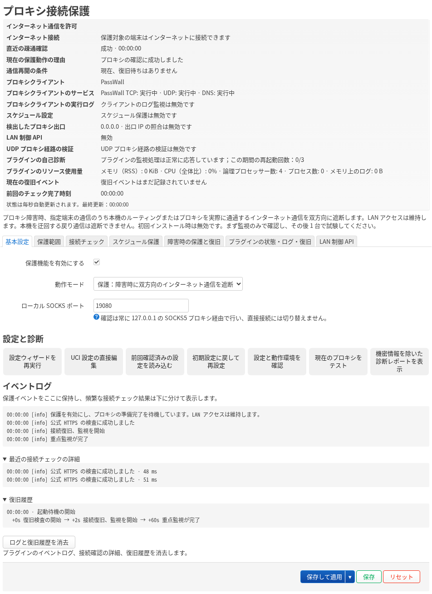

# Proxy Guard

[English](../README.md) · [简体中文](README.zh-CN.md) · [日本語](README.ja.md) · [Русский](README.ru.md) · [فارسی](README.fa.md)

**プロキシ障害時に、保護対象端末の意図しない直接接続を防ぎます。**

**対応プロキシクライアント：** PassWall · PassWall2 · OpenClash · Nikki · HomeProxy。対応状況はクライアントのバージョンと転送モードによって異なります。[互換性ガイド](COMPATIBILITY.ja.md)

Proxy Guard は OpenWrt と iStoreOS 向けの LuCI アプリです。保護を有効にすると、プロキシ障害を確認した時点で選択した端末のインターネット通信を遮断し、復旧確認に成功すると再開します。ルーターを通る IPv4・IPv6 の TCP・UDP 通信が対象で、確立済みの接続も含みます。

## バージョン 1.0.0

ファームウェアに合うパッケージを選びます。opkg には IPK（`1.0.0-8`）、apk には APK（`1.0.0-r8`）を使用します。[GitHub Releases](https://github.com/beezcheyenna/Proxy-Guard/releases) · [インストールガイド](USAGE.ja.md) · [変更履歴（英語）](CHANGELOG.ja.md)

## 主な機能

- **接続確認。** 既定では本機の SOCKS 経由で公式 HTTPS を使います。外部サイトの HTTPS 検査に切り替え、間隔や障害判定のしきい値を個別に設定できます。出口 IPv4 の照合を有効にすると、既定で公式サービスの結果を使います。
- **起動時・スケジュール・障害時の保護。** 起動中、毎日または指定曜日の時間帯、プロキシ障害の確認後に通信を遮断できます。プロキシクライアントのサービスとログも監視できます。
- **設定ウィザードと自動ロールバック。** 推奨された IPv4・IPv6 の範囲を確認し、適用後にルールを検証して 30 秒以内に設定を確定します。確認ダイアログには通信の許可または遮断状態が表示されます。
- **リアルタイムの状態表示と診断。** イベントと復旧の履歴を表示し、現在の入力内容を使って SOCKS 経由で接続をテストできます。必要なときに詳細な HTTPS 診断を一度実行できます。
- **オプションの LAN 制御 API。** 認証済みのクライアントは状態の取得、時間制限付き遮断の要求、自分の要求の取り消しができます。[API の使い方](USAGE.ja.md#local-api)
- **クライアント監視と自動復旧。** 設定したプロキシサービスと動作ログを監視します。Proxy Guard のプロセスが応答しない場合、設定した上限の範囲で再起動を試みます。

## インストールと初期設定

1. LuCI またはコマンドラインで、ファームウェアに合う 1.0 のパッケージをインストールします。
2. LuCI の **サービス → プロキシ接続保護** を開きます。ウィザードでクライアント、SOCKS ポート、入口インターフェース、アドレス範囲、ローカル通信の例外を確認します。最初は **監視のみ** を選び、**保存して適用** で設定を確定してから、端末 1 台の通信経路を確認してください。
3. 保護モードに切り替えて **保存して適用** を押します。自己診断後、30 秒以内に設定を確定します。ルールの確認が済むまで確定ボタンは無効で、カウントダウンは続きます。確定しなかった設定は自動で元に戻ります。

初回インストール時は保護、スケジュールによる遮断、出口 IPv4 の照合、LAN 制御 API が無効です。**保存**は変更の一時保存で、**保存して適用**で反映されます。

## 互換性と保護範囲

LuCI と firewall4/nftables が必要です。対象はルーターを実際に通る通信です。たとえば同じサブネット内で NAT を使わない場合、戻りの通信がルーターを経由しないことがあります。設定した LAN、DNS、管理アクセスの例外は維持されます。転送モードとフローオフロードの制限は[互換性ガイド](COMPATIBILITY.ja.md)を参照してください。

## ドキュメント

[ユーザーガイド](USER-GUIDE.ja.md) · [インストールと削除](USAGE.ja.md) · [トラブルシューティングと復旧](RECOVERY.ja.md) · [ソースからのビルド](BUILDING.ja.md) · [プライバシー](PRIVACY.ja.md) · [PGHB ハートビートと診断](PGHB.ja.md)

[MIT ライセンス](../LICENSE) · [第三者ソフトウェアの表示](THIRD_PARTY_NOTICES.ja.md) · [免責事項](DISCLAIMER.ja.md) · [貢献方法](CONTRIBUTING.ja.md)

[Proxy Guard 0.3 アーカイブ](../archive/0.3/README.md)
