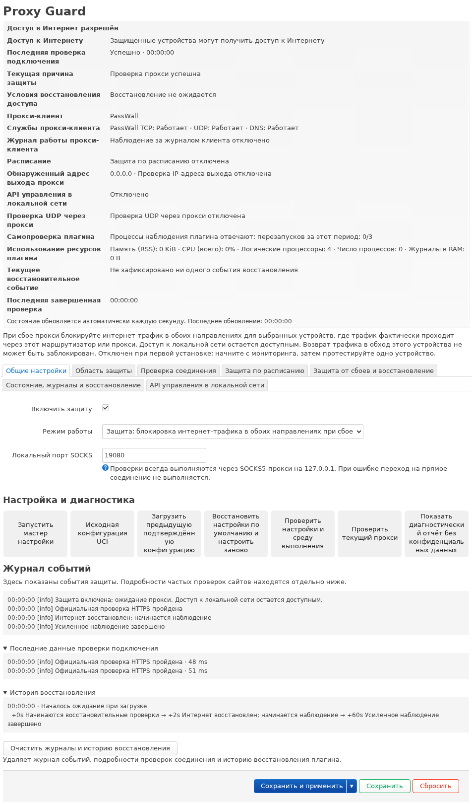

# Proxy Guard

[English](../README.md) · [简体中文](README.zh-CN.md) · [日本語](README.ja.md) · [Русский](README.ru.md) · [فارسی](README.fa.md)

**При сбое прокси блокирует нежелательные прямые подключения защищаемых устройств.**

**Поддерживаемые прокси-клиенты:** PassWall · PassWall2 · OpenClash · Nikki · HomeProxy. Совместимость зависит от версии клиента и режима перенаправления. [Руководство по совместимости](COMPATIBILITY.ru.md)

Proxy Guard — приложение LuCI для OpenWrt и iStoreOS. При включённой защите приложение блокирует доступ выбранных устройств в Интернет после подтверждённого сбоя прокси и восстанавливает его после успешных проверок. Защита охватывает TCP и UDP по IPv4 и IPv6, включая уже установленные соединения, которые проходят через маршрутизатор.

## Версия 1.0.0

Выберите пакет для своей прошивки. Для opkg используйте IPK (`1.0.0-8`), для apk — APK (`1.0.0-r8`). [GitHub Releases](https://github.com/beezcheyenna/Proxy-Guard/releases) · [Руководство по установке](USAGE.ru.md) · [Список изменений на английском](CHANGELOG.ru.md)

## Возможности

- **Проверка соединения.** По умолчанию используется официальный HTTPS-сервис через локальный SOCKS. Можно выбрать сторонние HTTPS-сайты и отдельно настроить интервалы и пороги сбоев. При включении сверки выходного IPv4 по умолчанию используется результат официального сервиса.
- **Защита при загрузке, по расписанию и при сбое.** Можно блокировать доступ во время запуска, ежедневно или в выбранные дни недели, а также при подтверждённом сбое прокси. Доступен контроль служб и журналов прокси-клиента.
- **Мастер настройки и автоматический откат.** Проверьте предложенную область IPv4 и IPv6. После применения проверьте правила и подтвердите настройки за 30 секунд. В диалоге показано, разрешён или заблокирован доступ.
- **Состояние и диагностика.** Просматривайте журнал событий и историю восстановления, проверяйте текущие значения формы через SOCKS или запускайте разовую подробную HTTPS-диагностику.
- **Локальный API управления.** Авторизованные клиенты могут получать состояние, запрашивать временную блокировку и отменять свои запросы. API включается отдельно. [Руководство по API](USAGE.ru.md#local-api)
- **Контроль клиента и автоматическое восстановление.** Отслеживает настроенные службы и журналы прокси. При зависании процессов Proxy Guard сторожевой процесс может перезапустить их в пределах заданного числа попыток.

## Установка и первоначальная настройка

1. Установите пакет версии 1.0 для своей прошивки через LuCI или командную строку.
2. В LuCI откройте **Службы → Proxy Guard**. Проверьте в мастере прокси-клиент, порт SOCKS, входные интерфейсы, диапазоны адресов и исключения для локальной сети. Выберите **Только наблюдение**, нажмите **Сохранить и применить**, подтвердите настройки и проверьте маршрут трафика одного устройства.
3. Включите режим защиты и нажмите **Сохранить и применить**. После самопроверки подтвердите настройки за 30 секунд. Пока правила проверяются, кнопка подтверждения недоступна, а отсчёт продолжается. Неподтверждённые настройки автоматически откатываются.

После чистой установки защита, блокировка по расписанию, проверка выходного IPv4 и локальный API выключены. Кнопка **Сохранить** сохраняет черновик. Кнопка **Сохранить и применить** вводит изменения в действие.

## Совместимость и область защиты

Требуются LuCI и firewall4/nftables. Защита действует на трафик, который действительно проходит через маршрутизатор. Например, в одной подсети без NAT обратный трафик может идти в обход маршрутизатора. Настроенные исключения для локальной сети, DNS и управления сохраняются. Ограничения по режимам перенаправления и ускорению потоков описаны в [руководстве по совместимости](COMPATIBILITY.ru.md).

## Документация

[Руководство пользователя](USER-GUIDE.ru.md) · [Установка и удаление](USAGE.ru.md) · [Восстановление](RECOVERY.ru.md) · [Сборка из исходников](BUILDING.ru.md) · [Конфиденциальность](PRIVACY.ru.md)

[Лицензия MIT](../LICENSE) · [Сторонние компоненты](THIRD_PARTY_NOTICES.ru.md) · [Отказ от гарантий](DISCLAIMER.ru.md) · [Участие в проекте](CONTRIBUTING.ru.md)

[Архив Proxy Guard 0.3](../archive/0.3/README.md)
