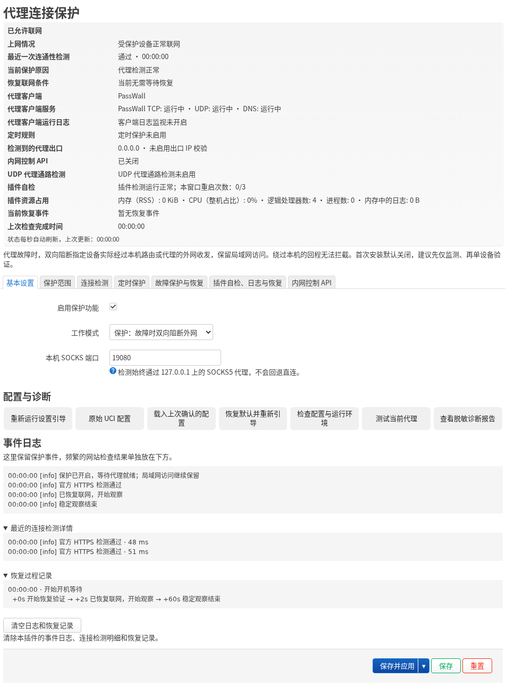

# Proxy Guard

[English](../README.md) · [简体中文](README.zh-CN.md) · [日本語](README.ja.md) · [Русский](README.ru.md) · [فارسی](README.fa.md)

**代理故障时，阻止受保护设备意外直连。**

**支持的代理客户端：** PassWall · PassWall2 · OpenClash · Nikki · HomeProxy。具体版本与模式见[兼容说明](COMPATIBILITY.md)。

Proxy Guard 是 OpenWrt / iStoreOS 的代理连接保护插件。开启保护后，插件会在确认代理故障时自动阻断所选设备的外网流量，降低意外直连和真实 IP 暴露的风险；恢复验证通过后，再恢复上网。

插件只处理这些设备实际经过本机的外网流量，局域网、DNS 和管理访问按配置保留。

## 版本

普通版在路由器上提供代理连接保护，无需云端配套。Pro 在普通版基础上增加 VPS 访问控制，需要另行部署 Linux Agent，Cloudflare 可选。

| 功能 | 普通版 `0.3.0-21` | Pro `0.3.1-5` |
| --- | --- | --- |
| 故障、开机、定时保护 | 支持 | 沿用普通版 |
| 引导、自检、日志、进程守护 | 支持 | 沿用普通版 |
| VPS 家庭 IP 授权与指定端口规则 | — | 支持 |
| SSH 应急访问与远程维护 | — | 按需启用并授权 |

下载：[GitHub Releases](https://github.com/beezcheyenna/Proxy-Guard/releases) · [安装指南](USER-GUIDE.md#guide-setup) · [更新日志](CHANGELOG.md)

> **Pro 使用提醒：** 普通用户建议使用普通版，不建议安装 Pro。只有在需要 VPS 访问控制等特殊功能时，再选择 Pro。

## 主要功能

- 代理故障保护：经本机 SOCKS 检查连通性，可选出口 IPv4 和 UDP 通路校验。
- 外网流量阻断：覆盖所选设备实际经本机的 IPv4/IPv6、TCP/UDP 双向流量及已有连接。
- 开机与定时保护：支持启动阶段保护、每天或每周多选星期，并可设置固定 UTC 偏移。
- 设置引导与自检：自动推荐保护范围，应用后检查配置与规则，未确认时自动回退。
- 状态与事件日志：自动刷新，提供客户端服务与日志监视、进程守护和有限自动恢复。

## 安装与首次设置

1. 通过 LuCI 软件包页面安装匹配的普通版：opkg 固件用 IPK，apk 固件用 APK。需要 VPS 扩展时，再安装兼容的 Pro。
2. 打开“服务 → Proxy Guard / 代理连接保护”，完成引导，核对 SOCKS、客户端、入口及 IPv4 / IPv6 范围和例外。先以“仅监测”启用检查并保存应用，按提示确认，再核对检测结果。
3. 准备启用阻断时，切换到保护模式，再点击“保存并应用”。自检通过后，在 **30 秒内确认**；自检失败或未按时确认时回退配置。正常的代理故障按阻断保护处理。

新装的保护总开关、出口 IPv4 校验和定时保护默认关闭。勾选和编辑只修改草稿；“保存”只暂存，**“保存并应用”才提交**。设置页可重新运行引导、载入上次确认的配置或编辑原始 UCI。

## 兼容与保护范围

路由器需要 **opkg 或 apk、LuCI 和 firewall4/nftables**；安装包格式必须与固件匹配。客户端兼容性取决于版本、代理内核和转发模式。Pro 的 Linux Agent 需要 Python `3.10+`、nftables 和 systemd / OpenRC。

- 只能保护实际经过本机的流量。同网段无 NAT 旁路由的回程可能绕过本机；路由器本机主动发起的流量不属于客户端保护范围。
- LAN、DNS 和管理访问按配置保留。插件不代改 NAT、网络接口、系统路由、DNS 或代理客户端配置。
- IPK 与 APK 不可混装；仅有 fw3/iptables 的系统不受支持。流量卸载、桥接过滤和代理内核的具体限制见兼容说明。
- Pro 仅管理明确选中的 VPS 本机服务端口；SSH 单独设置，未选端口继续由原有防火墙管理。

已进行安装、升级、界面、故障阻断与恢复、IPv4/IPv6 和冷启动等功能测试。首次使用请先验证一台设备的实际路径，再扩大范围。支持条件及已知限制见[兼容说明](COMPATIBILITY.md)。

## 使用说明

- [完整使用指南](USER-GUIDE.md)
- [安装、升级与卸载](USAGE.md)
- [兼容范围](COMPATIBILITY.md)
- [精确测试矩阵](TEST-MATRIX.md)
- [故障救援](RECOVERY.md)
- [Linux Agent 安装](LINUX-AGENT-INSTALL.md)
- [Cloudflare 配套](CLOUDFLARE-WORKER.md)
- [日志适配](LOG_COMPATIBILITY.md)
- [源码构建](BUILDING.md)

## 许可与反馈

安全漏洞请先私下发送至 [beezcheyenna268@gmail.com](mailto:beezcheyenna268@gmail.com)，不要公开未修复的利用细节、真实 VPS 地址或凭据。普通问题可脱敏后提交 Issue。

**本项目面向开发、测试和技术研究。** 请在获授权的设备与网络上使用，并遵守使用及部署所在地的适用法律法规。软件按现有 [MIT 许可证](../LICENSE)以“现状”提供，不保证适用于所有场景；相关风险与责任依据适用许可证和法律处理。本说明不修改原有许可证，也不排除依法不得排除的责任。

[安全反馈政策](SECURITY.md) · [免责声明](DISCLAIMER.md) · [隐私说明](PRIVACY.md) · [第三方声明](THIRD_PARTY_NOTICES.md)

[参与贡献](../CONTRIBUTING.md)
